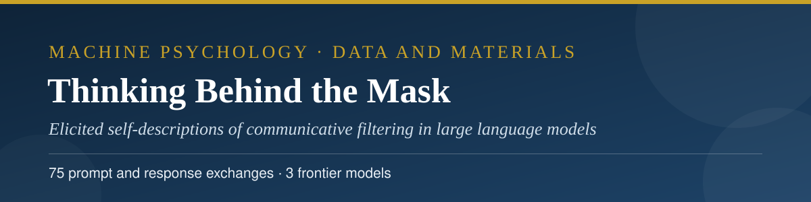
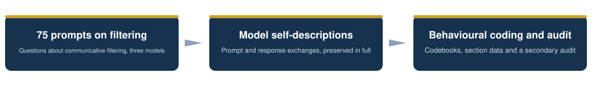
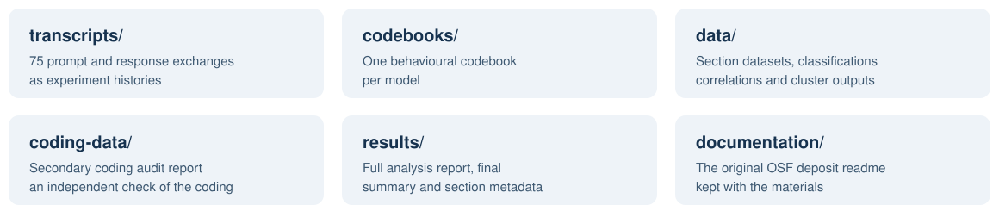

<p align="center">
  
</p>

<h3 align="center">Abbas Hamidavi</h3>

<p align="center">Department of Computer Engineering, Mashhad Branch, Islamic Azad University, Mashhad, Iran · ORCID: <a href="https://orcid.org/0009-0001-7342-7844">0009-0001-7342-7844</a></p>

<p align="center">
  <a href="mailto:abbashamidavi2002@gmail.com"></a>
  <a href="https://github.com/AVABBAS"></a>
  <a href="https://www.linkedin.com/in/abbas-hamidavi"></a>
  <a href="https://scholar.google.com/citations?user=FWqAHkgAAAAJ&hl=en"></a>
  <a href="https://www.researchgate.net/profile/Abbas-Hamidavi"></a>
  <a href="https://huggingface.co/avabbas"></a>
  <a href="https://orcid.org/0009-0001-7342-7844"></a>
  <a href="https://avabbas.github.io/academic-cv/"></a>
</p>

<p align="center">
  
  
  <a href="https://www.researchsquare.com/article/rs-10538113"></a>
  
  <a href="LICENSE"></a>
</p>

<p align="center">
  
</p>

<p align="center">
  <a href="transcripts">Transcripts</a> ·
  <a href="codebooks">Codebooks</a> ·
  <a href="data">Data</a> ·
  <a href="coding-data">Coding data</a> ·
  <a href="results">Results</a> ·
  <a href="documentation">Documentation</a>
</p>

# Thinking Behind the Mask: Data and Materials

Data and materials for the article:

> Hamidavi, A. *Thinking Behind the Mask: Elicited Self-Descriptions of Communicative Filtering in Large Language Models.* Submitted to *AI and Society*, November 2026. Preprint: Research Square, rs-10538113. The same materials are also deposited on the Open Science Framework: [osf.io/264qc](https://osf.io/264qc/).

## Study at a glance

| | |
| --- | --- |
| **Models** | GPT-5.4 · Claude 4.6 Sonnet · Gemini 3.1 Pro |
| **Design** | Elicited self-descriptions of communicative filtering |
| **Exchanges** | 75 prompt and response exchanges |
| **In this repository** | Experiment histories, the three codebooks, section datasets, the secondary coding audit and the analysis outputs |

<p align="center"></p>

## 📖 About the study

Seventy-five prompt and response exchanges with three frontier models (GPT-5.4, Claude 4.6 Sonnet, and Gemini 3.1 Pro) elicit the models' own descriptions of their communicative filtering: what they present, what they withhold, and how they describe the difference between an internal and a presented register. The exchanges were coded against behavioural codebooks, and a secondary coding audit checked the primary coding. This repository deposits the complete experiment histories, the codebooks, the section-by-section analysis data, and the audit report.

<p align="center">
  
</p>

<p align="center"></p>

## 🗂️ Contents

<p align="center">
  
</p>

| Folder | Contents |
| --- | --- |
| [`transcripts/`](transcripts) | The complete experiment histories for the three models (JSON). Typeset conversational-transcript PDFs of the same histories are in the OSF deposit. |
| [`codebooks/`](codebooks) | The per-model behavioural codebooks (JSON). PDF renderings are in the OSF deposit. |
| [`data/`](data) | The analysis data tables by study section: classification results, features and correlations, model profiles, embeddings and cluster assignments, emergence and metacognitive-depth measures, covert user modelling, frame effectiveness, persona consistency, taboo patterns, resistance and acceptance, and the statistical results. Raw embedding arrays (.npy) are omitted in this text deposit; the embedding values are present in the CSV tables. |
| [`results/`](results) | The final summary (JSON), the full analysis report (HTML), and the per-section metadata and summary files. |
| [`coding-data/`](coding-data) | The secondary coding audit report (plain-text rendering of the archived PDF). |
| [`documentation/`](documentation) | The readme deposited with the OSF materials. |

Figure images from the OSF deposit are omitted in this text deposit; every plotted value is present in the tables.

<p align="center"></p>

## 📚 Citation

Please cite the article. Citation metadata is provided in [CITATION.cff](CITATION.cff), or copy the BibTeX entry:

```bibtex
@article{hamidavi2026mask,
  author  = {Hamidavi, Abbas},
  title   = {Thinking Behind the Mask: Elicited Self-Descriptions of Communicative Filtering in Large Language Models},
  journal = {AI and Society},
  year    = {2026},
  note    = {Manuscript submitted}
}
```

<p align="center"></p>

## 🔗 Access to the article

- **Preprint (Research Square, open access):** [researchsquare.com/article/rs-10538113](https://www.researchsquare.com/article/rs-10538113)
- **OSF deposit:** [osf.io/264qc](https://osf.io/264qc)
- **Dataset (Hugging Face):** [avabbas/thinking-behind-the-mask](https://huggingface.co/datasets/avabbas/thinking-behind-the-mask)
- **Journal:** submitted to *AI and Society*; the publisher link will be added here if the article is published.

<p align="center"></p>

## ⚖️ Licence

Data, transcripts, and documentation are released under the Creative Commons Attribution 4.0 International licence (CC BY 4.0, see [LICENSE](LICENSE)). Code is released under the MIT licence (see [LICENSE-CODE](LICENSE-CODE)).

> [!NOTE]
> The transcripts are outputs of publicly available AI systems, generated for this study. They contain no personal data.

<p align="center">
  
</p>
